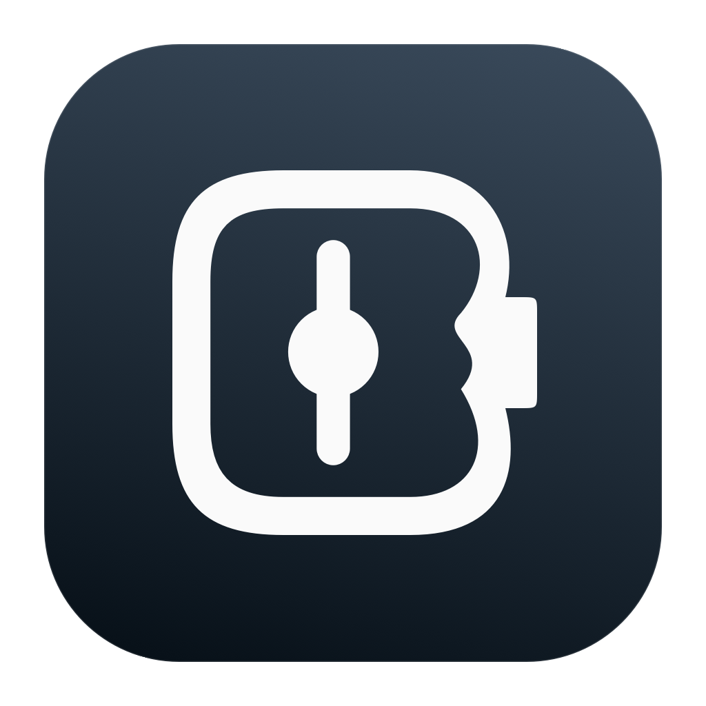

# Battune

**Lightweight native battery charge control for macOS.** Tune your battery.

Version **0.1.0-beta.1** · MIT · macOS 13+ · no telemetry · no network services

Battune is a native menu-bar application with a deterministic Rust control engine
and a separate, narrowly scoped privileged helper. It is an independent implementation.

**Real native charge-limit control is implemented on supported Apple Silicon Macs.**
Battune uses the same macOS charge service as System Settings, with a verified
write/readback cycle and restoration of the previous limit. On the tested Mac16,12
(macOS 27.0.1), the supported limits are **80, 85, 90, 95 and 100%**. No root helper
or Apple developer identity is required for this native path. The advanced **CHIE adapter mode** additionally implements 20–100% limits,
forced discharge and calibration. It needs an administrator-approved helper and
an explicit off/on/readback test. That off/on/readback test and local helper installation succeeded on this host; see
[features and permissions](docs/FEATURE_PERMISSIONS.md).

## Features

- Native AppKit menu bar and SwiftUI settings in English and German.
- Real IOKit battery readings, explicit unknown values, event-driven updates and sleep/wake handling.
- Real native charge limits with runtime detection of supported values.
- Advanced 20–100% adapter control, sailing, thermal protection and fail-safe recovery.
- Explicit discharge and cancellable calibration workflows, gated by backend capabilities.
- Weekly schedules with local timezone and daylight-saving handling.
- Live temperature/voltage/current/power/capacity, bounded history, 24h/7d/30d charts, CSV and diagnostic exports.
- Validated preferences, launch at login, onboarding and reset/recovery UI.
- XPC authentication, argument validation, write deduplication, rate limits and expiring control leases.

The native write/restore path has been tested on the local Mac. Advanced workflows and adapter failures have been exercised against a **test-only transport**; real privileged adapter off/on/readback and restoration are also verified locally.
Unsupported real operations are displayed as unsupported, never reported as successful.

## Beta installieren / Install beta



Download **Battune-0.1.0-beta.1.pkg** from the
[GitHub beta release](https://github.com/cykawatte/Battune/releases/tag/v0.1.0-beta.1).
Quit an existing Battune instance, open the installer, approve the administrator
installation, then launch **Battune** from Applications. The package includes the
app and matching privileged helper. The first-run tour explains core features
and the explicit hardware-test/advanced-mode setup. Installing the helper does
not automatically enable adapter control.

**Deutsch:** Das vollständige Paket installiert App und Helper gemeinsam. Battune
anschließend unter Programme starten und der kurzen Einführung folgen.
[Installationsanleitung / installation and recovery](packaging/INSTALL.md).
The ZIP also contains the instructions, helper-only repair package and uninstaller.
Checksums are provided in `SHA256SUMS.txt`.

This beta is **ad-hoc signed, not Developer ID signed or notarized**. macOS may
require an explicit exception for this download; do not disable system-wide
security protections. The repository remains private, so testers need GitHub access.

## Hardware support

See [hardware validation matrix](docs/HARDWARE_SUPPORT.md). arm64 and x86_64 are
build targets, **not claims of verified charge-control compatibility**. A missing
battery, capacity measurement or temperature is represented as unknown.

## Requirements and developer installation

- macOS 13 or newer; Command Line Tools or Xcode with Swift 5.9 or newer.
- Stable Rust with Cargo, rustfmt and clippy, installed using [rustup](https://rust-lang.org/tools/install/).
- `swift format` (included in the tested Swift 6.4 toolchain) for the full lint gate.
- No package-manager runtime libraries or external Swift/Rust packages.

Verified locally with Swift 6.4, Rust 1.99.0 and SDK 27.0. Full Xcode is optional
for script builds. The standalone Swift test runner works without XCTest.

```sh
./scripts/build.sh
open build/debug/Battune.app
```

All commands run from the repository root. The build creates an ad-hoc signed
local app and embeds the helper; **it does not register or run a privileged daemon**.

```sh
./scripts/lint.sh
./scripts/test.sh
./scripts/build.sh release

# Optional universal build; install both Rust target standard libraries first.
export PATH="$HOME/.cargo/bin:$PATH"
rustup target add aarch64-apple-darwin x86_64-apple-darwin
./scripts/build.sh release universal
open build/release/Battune.app
```

Open `Battune.xcodeproj` in full Xcode to use its Debug/Release wrapper around the
same scripts. The Xcode GUI workflow requires separate validation; CLT builds
and the native test runner are the authoritative locally exercised route.
For direct SwiftPM commands, run `./scripts/rust-build.sh` first. Build scripts
set architecture and configuration paths automatically.

## Architecture

```text
AppKit / SwiftUI → Swift coordinator → value-based C ABI → pure Rust policy
                       ↓
                authenticated XPC → minimal Swift helper → hardware backend
IOKit power notifications → local snapshots ↗
```

Rust has no IOKit, XPC, UI or file-system knowledge. Helpers have no charge-policy
logic. [Architecture](docs/ARCHITECTURE.md), [ADRs](docs/adr/0001.md),
[battery policy](docs/BATTERY_CONTROL.md), [test guide](docs/TESTING.md).

## Security and reset

The optional root helper authenticates exact app identity through matching Apple
team signatures or administrator-installed exact code hashes for local builds.
There is no unrestricted unsigned bypass or arbitrary SMC write API. See the
[security model](docs/SECURITY_MODEL.md).

Native reset restores the previous macOS limit while still owned. Advanced reset
restores the journaled adapter input. Sleep, lease expiry and reserve protection
revoke advanced validation. A killed helper recovers at launchd restart; failed
hardware access cannot be repaired by a software promise.

```sh
# Prepare only; does not install or run privileged software:
./scripts/build-helper-installer.sh release
```

The complete beta installer includes the matching helper. Setup can also open a
helper-only repair package. After every rebuild, regenerate/reinstall the package
because exact code signatures change.
[Permission, recovery and uninstall instructions](docs/FEATURE_PERMISSIONS.md).

## Privacy

No telemetry, analytics, accounts, ads, cloud backend, update checker or runtime
network access. History and settings stay local. [Privacy policy](PRIVACY.md).

## Known limitations

- Native setting writes/readbacks and restoration tested; a complete charge cycle
  with AC attached has not been observed. macOS may occasionally charge to 100%
  for calibration, as documented by Apple.
- The native PowerUI interface is private: runtime ABI checks fail closed when it
  changes. Only the values reported by macOS are accepted.
- Direct SMC writes, forced discharge, custom thermal thresholds and sailing
  remain unsupported by the native backend.
- Local helper installation, exact-hash XPC and CHIE switching were verified with approval. Sustained discharge/calibration, sleep/crash restoration and published Team-ID signing remain untested.
- macOS 13 and Intel runtime behavior require testing on those machines.
- Sensor fields vary by device. This host now exposes temperature through SMC and actual mAh capacities in nested BatteryData.
- Advanced control restores AC input on sleep and requires another validation after wake. Calibration interrupts on sleep/restart; it does not resume automatically.
- Adapter mode uses battery during holds, adds cycles and does not enforce the software charge limit while asleep.
- Native SwiftPM build mode is used for CLT compatibility; Swift 6.4 warns that
  this build mode is deprecated. Migration is tracked in the architecture notes.
- Performance budgets are goals. See actual measurements and unmeasured metrics
  in [PERFORMANCE.md](docs/PERFORMANCE.md).

## Packaging and release

```sh
./scripts/build.sh release universal
./scripts/package.sh
./scripts/verify-package.sh
```

Produces a complete app/helper installer, helper-only repair installer, ZIP and
SHA-256 checksums in `build/packages`. CI builds and validates these artifacts on
pushes and pull requests. Packaging never installs or uploads automatically.
See [release procedure and final-release gates](docs/RELEASING.md).

## Contributing and license

Read [CONTRIBUTING.md](CONTRIBUTING.md), [SECURITY.md](SECURITY.md) and
[THIRD_PARTY_NOTICES.md](THIRD_PARTY_NOTICES.md). Licensed under [MIT](LICENSE),
copyright Battune contributors. See [FINAL_REPORT.md](FINAL_REPORT.md) for the
status of this development iteration.

## Native limits and standby / Native Grenzen und Standby

Supported limits (80/85/90/95/100% on the tested Mac) always use macOS control,
even with advanced mode unlocked. Battune keeps adapter input enabled and does
not clear the native limit on sleep. Explicit discharge/calibration temporarily
uses the helper and returns to the native limit afterwards. Apple may occasionally
exceed native limits for gauge calibration; this is not a promise of an absolute ceiling.
Other limits still require adapter mode: battery use during holds, no enforcement
while asleep. Physical overnight sleep behavior remains to be measured.

**Deutsch:** Bei unterstützten Grenzen wie 80 % bleibt der Netzteileingang aktiv.
Der erweiterte Modus ersetzt diese Regelung nicht mehr durch Batteriezyklen.
Die native Grenze bleibt im Standby gesetzt; gelegentliche Apple-Vollladungen zur
Messwertkalibrierung bleiben möglich. Andere Grenzen gelten nur im Wachzustand.
